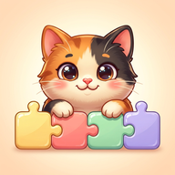
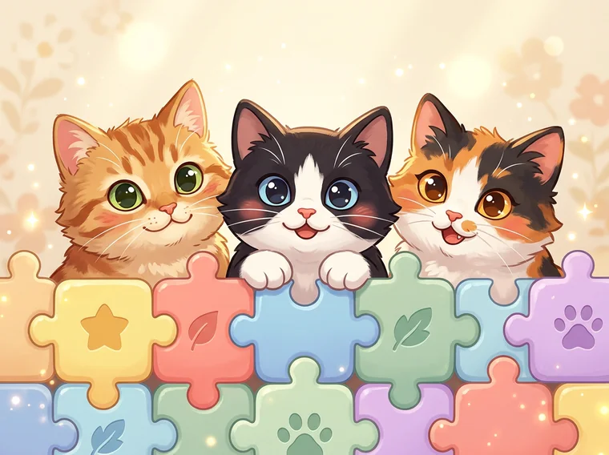

<div align="center">



# Meowdoku — Find the Hidden Cats

**An offline-first cat logic puzzle Progressive Web App (PWA) inspired by Meowdoku, Star Battle, and LinkedIn Queens — built with React 19, TypeScript, Tailwind CSS 4, Zustand, and Vite.**

[](https://react.dev/)
[](https://www.typescriptlang.org/)
[](https://vite.dev/)
[](https://tailwindcss.com/)
[](#offline-first-pwa--architecture)
[](#localization-en--fr)
[](#testing--quality-assurance)
[](#testing--quality-assurance)

<br />



</div>

---

## What Is Meowdoku?

**Meowdoku — Find the Hidden Cats** is a casual, mobile-first **cat logic puzzle web game** where players deduce the exact hiding spot of every cat on a colored grid using pure logic—never guesswork. Every campaign level, daily puzzle, and weekly trial is mathematically verified to have a **single unique solution** solvable by human deduction techniques.

Designed as an installable **offline-first Progressive Web App (PWA)**, Meowdoku combines clean logic gameplay with a Candy Crush–style vertical world journey, progressive teaching hints, collectible cats, procedural SVG accessories, seasonal collections, and full **English (`en`)** and **French (`fr-FR`)** localization.

### At a Glance

| Category | Details |
| :--- | :--- |
| **Genre** | Casual Logic Puzzle / Spatial Deduction (Queens / Star Battle–style grid) |
| **Campaign** | **24 handcrafted & solver-verified levels** (`6×6` and `8×8`) across **4 themed worlds** |
| **Daily & Weekly Modes** | Deterministic **Daily Kitty (`8×8`)** puzzle and weekly **Golden Cat Trial (`8×8`)** |
| **Play Modes** | **Classic Mode** (3 hearts, stars, personal bests) & **Practice Mode** (stress-free, no hearts lost) |
| **Collection & Cosmetics** | **10 collectible cats** across **3 sets** + **14 procedural SVG accessories** (100% cosmetic-only) |
| **Progression & Rewards** | Daily reward calendar v2, Streak Freezes (max 3) & recovery, Daily/Weekly/Milestone missions, **28 achievements**, Treasure chests v2 (published 70/25/5 odds) & perfect-solve bonuses |
| **Adaptive & Onboarding** | Guided 4×4 interactive first-run onboarding, on-device skill profile, adaptive recommendations, and Relaxed/Standard/Tricky Daily difficulty choice |
| **Session, Safety & Stats** | Welcome-back summaries, break reminders, varied local reminders v2, opt-in Family-friendly mode (parent gate), and local "My stats" sheet with 14-day chart & JSON export |
| **Languages** | Full **English** and **French (`fr-FR`)** UI, tutorials, voice/audio, dates, and localized pluralization |
| **Platform** | Installable **Offline-First PWA** (Android, iOS Safari, Desktop) with Service Worker + IndexedDB + LocalStorage |

---

## How to Play (Puzzle Rules)

Every grid is divided into colored regions equal to the grid size (`6×6` has 6 regions; `8×8` has 8 regions). Place **one cat** in each region following three simple rules:

1. **One cat per colored region** — Every pastel region hides exactly one cat.
2. **One cat per row and column** — Each horizontal row and vertical column contains exactly one cat.
3. **No touching cats** — Cats can never occupy adjacent cells, including diagonally (`8`-neighbor exclusion).

### Verified Human-Logic Deduction Engine

Unlike brute-force puzzle generators that create unfair guessing boards, [`src/game/logicalSolver.ts`](src/game/logicalSolver.ts) analyzes and verifies every puzzle across ranked human deduction techniques:

| Rank | Technique | Description |
| :---: | :--- | :--- |
| **0** | Naked Singles | Only one open cell remains in a region, row, or column. |
| **1** | Region–Line Intersections | All candidates of a region lie in one row/column, eliminating the rest of that line (and vice versa). |
| **2** | Blocking / Adjacency Exclusion | Any cell that eliminates every valid candidate in another region or line cannot hold a cat. |
| **3** | Group Confinement (Pigeonhole) | *K* regions confined to *K* rows or columns lock out all other cells in those lines. |
| **4** | One-Step "What If" Contradiction | Testing a single placement leads directly to a logical dead end. |

---

## Key Features

### Puzzle Gameplay & Mobile UX
- **Teaching Progressive Hints** — Multi-stage hints explain *why* a cell is eliminated or forced instead of simply giving away the answer.
- **Flexible Controls & Pencil Marks** — Tap-to-confirm or direct tap modes, drag-to-paint `×` marks, Smart Auto-`×`, candidate dots, row/column/neighbor sightlines, and full undo/redo history.
- **Classic & Practice Modes** — Classic mode tracks 3 hearts, 1–3 star ratings, best times, zero-mistake solves, and personal-best improvements; Practice mode lets players relax with zero heart penalties.
- **Per-Level Save Slots** — Up to 5 in-progress campaign boards plus separate Daily Kitty and Golden Cat Trial save slots persist automatically across sessions.
- **Accessibility** — High-contrast theme, large-text mode, region symbols for color-blind players, `reducedMotion` support, and semantic ARIA progress bars and grid attributes.

### World Map, Progression & Player-Friendly Retention
- **4-World Vertical Journey Map** — Climb through *Kitty Village*, *Candy Garden*, *Moonlit Valley*, and *Starlight Castle* with special Treasure, Bonus, Cat Rescue, and Boss nodes plus a level details sheet showing personal bests and attempt history.
- **Daily Reward Calendar v2** — Data-driven 7-day cycle with escalating Day 7 grand prizes, once-ever streak milestones (`7`, `14`, `30`, `60` days), deterministic 10% lucky bonus with published in-app odds, and zero dark patterns.
- **Friendlier Streaks** — Earned **Streak Freezes** (capped at 3, earned on Day 7 and weekly Golden Cat Trials), non-resetting calendar position on breaks, and free one-tap recovery through Classic play.
- **Missions v2 & Achievements v2** — Daily missions (with 1 free daily swap and yesterday no-repeat), deterministic Weekly missions, a 9-step permanent Milestone ladder, and **28 categorized badges** (Progress, Skill tiers, Daily/Weekly, World Mastery, and Logic Techniques).
- **Collectible Cats & Procedural SVG Accessories** — Unlock 10 unique cats across 3 sets (*Village Friends*, *Garden Friends*, *Starry Night Friends*), view join history and profiles, mark favourites, and dress your companion in 14 flat-fill SVG accessories—including annual **Seasonal Collections** (Winter, Spring, Summer, Autumn) that return every year with zero countdown pressure.
- **Cosmetic-Only Guarantee** — Enforced by static unit test [`src/game/cosmeticGuarantee.test.ts`](src/game/cosmeticGuarantee.test.ts): cats and accessories never affect puzzle difficulty, hints, validation, or economy payouts.

### Localization (EN / FR)
- Complete **English** and **French (`fr-FR`)** localization powered by `i18next` and `react-i18next`.
- Automatic browser language detection, instant language switcher in Settings, locale-aware date/time formatting, and automated EN/FR key-parity verification in [`src/i18n/i18n.test.ts`](src/i18n/i18n.test.ts).

### Offline-First PWA & Architecture
- **Installable Native-Like Experience** — Valid `manifest.webmanifest`, full icon set (`16px`–`1024px`, standard & maskable, Apple Touch Icon), Android install prompt, and guided iOS Safari Add-to-Home-Screen modal.
- **Reliable Offline Play** — Versioned Service Worker ([`public/sw.js`](public/sw.js)) with Vite-generated `asset-list.json` runtime cache pruning and non-disruptive update banners (never interrupts an active puzzle).
- **Durable Local Persistence** — Schema-validated LocalStorage mirrored to IndexedDB ([`src/utils/storage.ts`](src/utils/storage.ts), [`src/utils/idbStorage.ts`](src/utils/idbStorage.ts)) with backwards-compatible migrations and corruption recovery backups.
- **120fps Rendering & Audio** — Route-based lazy code splitting, memoized tile cells, zero-idle-CPU HTML5 Canvas particles, Web Audio synthesizer SFX, and Vibration API haptics.

---

## Tech Stack

| Layer | Technologies |
| :--- | :--- |
| **UI & Framework** | [React 19](https://react.dev/), [TypeScript 5.7](https://www.typescriptlang.org/) (strict mode) |
| **Styling & Animation** | [Tailwind CSS 4](https://tailwindcss.com/), [Framer Motion 12](https://motion.dev/), [Lucide Icons](https://lucide.dev/), custom procedural SVG |
| **State & Persistence** | [Zustand 5](https://zustand.docs.pmnd.rs/), LocalStorage + IndexedDB dual-layer storage |
| **Internationalization** | [i18next](https://www.i18next.com/) + [react-i18next](https://react.i18next.com/) (`en`, `fr-FR`) |
| **Build & PWA** | [Vite 6](https://vite.dev/), custom Service Worker (`sw.js`), Web App Manifest |
| **Testing** | [Vitest 4](https://vitest.dev/) (unit & store integrity) + [Playwright 1.55](https://playwright.dev/) (real-browser mobile E2E in EN & FR) |

---

## Project Structure

```text
find-hidden-cat/
├── public/
│   ├── icons/                  # PWA icons (16px–1024px, maskable & Apple Touch)
│   ├── media/                  # WebP chapter art, audio & celebration assets
│   ├── manifest.webmanifest    # Installable PWA manifest
│   └── sw.js                   # Offline-first Service Worker with asset pruning
├── src/
│   ├── components/             # Game board, SVG CatIllustration & accessories, modals, nav
│   ├── game/                   # Pure TypeScript puzzle engine, solver, hints, economy,
│   │                           # daily rewards, missions, achievements, cats, sets, seasons, chests,
│   │                           # adaptive skill & recommendations, family mode & stats export
│   ├── i18n/locales/           # Complete EN and FR translation bundles + parity tests
│   ├── screens/                # Lazy-loaded screens (Welcome, Onboarding, Map, Game, Victory,
│   │                           # Missions, Cats, Shop, Profile, Settings, Tutorial)
│   ├── services/               # PWA lifecycle, local reminder planner, notifications, play session, ads
│   ├── store/                  # Zustand gameStore + integrity tests
│   └── utils/                  # Schema-validated storage, IndexedDB mirror, audio, haptics
└── e2e/
    ├── run.mjs                 # Playwright runner against Vite production preview
    └── specs/                  # 21 E2E specs covering smoke, hearts, offline, layout, onboarding,
                                # chests, daily variants, welcome-back, exits, 4x CPU perf, family mode & stats
```

---

## Getting Started

### Prerequisites
- **Node.js 20+** (tested on Node.js 22)
- **npm 10+**

### Local Development

```bash
git clone https://github.com/wassim-azi/find-hidden-cat.git
cd find-hidden-cat
npm install
npm run dev
```

Open the local URL printed by Vite (default `http://localhost:5173`).

### Available Scripts

| Command | Description |
| :--- | :--- |
| `npm run dev` | Start Vite dev server with LAN host access (`--host`) |
| `npm run build` | Run strict TypeScript project check (`tsc -b`) and Vite production build |
| `npm run preview` | Preview the built production bundle locally |
| `npm test` | Run all **38 Vitest test suites (278 tests)** |
| `npm run test:watch` | Run Vitest in interactive watch mode |
| `npm run e2e` | Build production app and run all **21 Playwright E2E specs (134 checks)** across EN & FR |

---

## Testing & Quality Assurance

Meowdoku enforces strict quality gates before every release:

- **Unit & Engine Integrity (`npm test`)** — 38 test files / 278 tests verifying puzzle uniqueness, logical solvability without guessing, hint correctness, economy payout integrity, clock-tampering protection, storage migrations, EN/FR i18n parity, and the cosmetic-only guarantee.
- **End-to-End Mobile Browser Suite (`npm run e2e`)** — 21 Playwright specs / 134 checks validating full gameplay solves, guided 4×4 onboarding, Classic heart depletion, offline Service Worker reloads, responsive viewports (`320×568` through `412×915`) with zero horizontal overflow, reminders, daily calendar, missions, badges, cat profiles, all 14 SVG accessories, seasonal collections, treasure chests with published odds, daily difficulty variants, welcome-back summaries, clean screen exits, 4× CPU victory celebration performance, opt-in family-friendly mode with parent gate, and local stats JSON export in both `en-US` and `fr-FR`.

---

## Frequently Asked Questions (FAQ)

### Are Meowdoku puzzles guaranteed to be solvable without guessing?
Yes. Every campaign level (`1`–`24`), Daily Kitty puzzle, and weekly Golden Cat Trial is verified by [`src/game/logicalSolver.ts`](src/game/logicalSolver.ts) and [`src/game/engineIntegrity.test.ts`](src/game/engineIntegrity.test.ts) to have **exactly one solution** reachable via human logic deductions.

### Can I play Meowdoku offline?
Yes. After the first load, the Service Worker caches the app shell, translations, and core assets while IndexedDB + LocalStorage preserve campaign progress, active boards, rewards, and settings completely offline.

### Do collectible cats or accessories give gameplay advantages?
No. All collectible cats, cat sets, and seasonal/set/chest SVG accessories are **strictly cosmetic**, enforced by an automated static test ([`src/game/cosmeticGuarantee.test.ts`](src/game/cosmeticGuarantee.test.ts)).

### Does the game support French?
Yes. Every screen, puzzle hint, modal, notification, date format, and achievement is localized in both **English** and **French (`fr-FR`)**.

---

## Roadmap

Development follows a phased public roadmap tracked in [Issue #31](https://github.com/wassim-azi/find-hidden-cat/issues/31):

- **Phases 0–4 (Completed):** Core integrity & E2E suite, gameplay event stats, personal bests & "next goal" engine, Daily Calendar v2, friendlier streaks & freezes, guided 4×4 interactive onboarding, Missions v2, Achievements v2 (28 badges), Cat profiles & unlock history, Cat sets & 14 SVG accessories, and Seasonal collections.
- **Phases 5–9 (Completed):** Treasure chests v2 with published 70/25/5 odds, perfect-solve & milestone chests, on-device skill profile, adaptive recommendations & Relaxed/Standard/Tricky Daily difficulty choice, welcome-back summaries, break reminders & exit audit, varied reminders v2, 60fps `ParticleCanvas` celebrations, opt-in Family-friendly mode with parent gate, and local "My stats" sheet with 14-day chart & anonymous JSON export.
